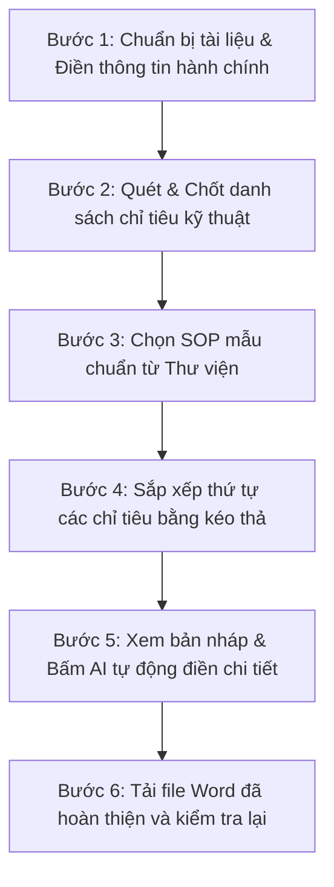

# TÀI LIỆU HƯỚNG DẪN VẬN HÀNH & SỬ DỤNG HỆ THỐNG QC AI (CPC1HN)

Hệ thống **QC AI (CPC1HN)** là một nền tảng phần mềm thông minh được thiết kế chuyên biệt cho phòng Đảm bảo chất lượng (QA) và Kiểm tra chất lượng (QC) của nhà máy dược phẩm CPC1 Hà Nội. Hệ thống ứng dụng công nghệ Trí tuệ Nhân tạo (Generative AI) cùng các thuật toán bóc tách dữ liệu nâng cao để tự động hóa quy trình phân tích Dược điển (USP, BP, EP, DĐVN), COA, MOA nhằm lập hồ sơ kiểm nghiệm nguyên liệu và thiết lập tiêu chuẩn nguyên liệu.

Tài liệu này cung cấp hướng dẫn vận hành chi tiết, cấu trúc thành phần hệ thống và hướng dẫn sử dụng thực tế dành cho kiểm nghiệm viên và quản trị viên hệ thống.

---

## MỤC LỤC
1. [Kiến Trúc Hệ Thống & Cấu Trúc Thư Mục](#1-kiến-trúc-hệ-thống--cấu-trúc-thư-mục)
2. [Chi Tiết Chức Năng Các Thành Phần Giao Diện (UI Modules)](#2-chi-tiết-chức-năng-các-thành-phần-giao-diện-ui-modules)
3. [Cơ Chế Vận Hành Kỹ Thuật & Xử Lý Cốt Lõi](#3-cơ-chế-vận-hành-kỹ-thuật--xử-lý-cốt-lõi)
4. [Hướng Hướng Nghiệp Vụ Thực Tế (Kịch Bản Sử Dụng)](#4-hướng-dẫn-nghiệp-vụ-thực-tế-kịch-bản-sử-dụng)
5. [Khắc Phục Sự Cố & Câu Hỏi Thường Gặp (Troubleshooting)](#5-khắc-phục-sự-cố--câu-hỏi-thường-gặp-troubleshooting)

---

## 1. KIẾN TRÚC HỆ THỐNG & CẤU TRÚC THƯ MỤC

Hệ thống được thiết kế theo mô hình **Modular Desktop Web Application** sử dụng Streamlit làm giao diện và Python làm động cơ xử lý ngầm. 

### 1.1. Sơ Đồ Cấu Trúc Thư Mục
Dưới đây là sơ đồ tổ chức mã nguồn và các file dữ liệu của hệ thống:

```
d:\QC_AI_Win/
├── CaiDat_ThuVien.bat         # File script cài đặt các thư viện Python tự động
├── KhoiDong_QC_AI.bat         # File script khởi chạy hệ thống ở chế độ chạy ngầm
├── run_app.py                 # Bộ giám sát tiến trình Streamlit và điều hướng lệnh
├── main.py                    # Điểm khởi nhập ứng dụng, cấu hình giao diện & routing
│
├── core/                      # LỚP XỬ LÝ LOGIC CỐT LÕI (BACKEND ENGINE)
│   ├── __init__.py
│   ├── ai_handler.py          # Gọi API AI (Gemini, OpenAI), tự phục hồi lỗi, chia tải
│   ├── doc_processor.py       # Đọc PDF/Word/Ảnh, chạy OCR, bóc tách chỉ tiêu đa luồng
│   ├── word_exporter.py       # Đổ dữ liệu vào template Word, định dạng rich-text song ngữ
│   ├── key_manager.py         # Quản lý khóa API, cấu hình model (mã hóa tĩnh)
│   ├── auth_manager.py        # Xác thực mật khẩu chủ, quản lý mã PIN 2FA (TOTP)
│   ├── crypto_utils.py        # Các hàm băm bcrypt, mã hóa khóa AES-256
│   ├── decision_module.py     # Module hỗ trợ phân tích logic
│   ├── drag_drop_component/   # Component tùy biến để kéo thả sắp xếp chỉ tiêu
│   └── paste_image_component/ # Component tùy biến hỗ trợ dán trực tiếp ảnh từ clipboard
│
├── ui_modules/                # LỚP GIAO DIỆN NGƯỜI DÙNG (FRONTEND MODULES)
│   ├── __init__.py
│   ├── ui_ho_so.py            # Chức năng Lập Hồ Sơ Kiểm Nghiệm Nguyên Liệu (HSKN)
│   ├── ui_tcnl.py             # Chức năng Tạo Tiêu Chuẩn Nguyên Liệu (TCNL)
│   ├── ui_chi_tieu.py         # Chức năng Quản lý từ điển chỉ tiêu & Luật bóc tách AI
│   ├── ui_thu_vien.py         # Chức năng Quản lý các phương pháp phân tích cốt lõi
│   ├── ui_sop_library.py      # Chức năng Quản lý các quy trình SOP mẫu tham chiếu
│   ├── ui_reagent.py          # Chức năng Quản lý thư viện thuốc thử/dung dịch & dịch AI
│   ├── ui_phong_cach.py       # Chức năng Training AI (học phong cách từ hồ sơ mẫu)
│   └── ui_api_key.py          # Giao diện quản lý khóa bảo mật, PIN 2FA
│
└── CƠ SỞ DỮ LIỆU CẤU HÌNH (JSON) & TEMPLATE (WORD)
    ├── criteria_master.json      # Từ điển chứa toàn bộ chỉ tiêu kiểm nghiệm mẫu
    ├── method_library.json       # Thư viện định nghĩa các phương pháp phân tích lõi
    ├── reagent_library.json      # Danh mục cách pha thuốc thử, dung dịch chuẩn
    ├── sop_reference_library.json # Danh mục quy trình SOP hoàn chỉnh của các chỉ tiêu
    ├── personal_style.json       # Phong cách viết lách, cấu trúc HPLC/TLC đã được học
    ├── api_key.json              # Chứa các API key đã được mã hóa AES-256
    ├── model_config.json         # Danh sách cấu hình các mô hình AI khả dụng
    ├── Template_Form_KNNL.docx   # Mẫu Word xuất Phiếu kiểm nghiệm nguyên liệu
    └── Template_Form_TCNL.docx   # Mẫu Word xuất Tiêu chuẩn nguyên liệu
```

### 1.2. Vai Trò Của Các File Cơ Sở Dữ Liệu JSON
- **`criteria_master.json`**: Lưu trữ các chỉ tiêu kiểm nghiệm (ví dụ: `cam_quan`, `dinh_tinh`, `do_tan`, `mat_khoi_luong_do_say`). Mỗi chỉ tiêu chứa tên hiển thị, ghi chú dịch thuật bắt buộc, lệnh prompt AI cho từng nguồn tài liệu (COA, Dược điển, MOA) và các ví dụ Few-Shot.
- **`method_library.json`**: Định nghĩa cách phân loại phương pháp phân tích (như HPLC, TLC, Chuẩn độ). AI sử dụng danh mục này để xác định cấu trúc đầu ra cần bóc tách.
- **`sop_reference_library.json`**: Kho chứa các quy trình SOP mẫu chuẩn của nhà máy. Khi tạo hồ sơ, hệ thống sẽ ưu tiên nạp nội dung mẫu từ đây nếu chỉ tiêu khớp từ khóa, đảm bảo độ chuẩn xác 100% theo SOP hiện hành.
- **`reagent_library.json`**: Lưu công thức và cách pha chế của hàng trăm loại thuốc thử, dung dịch chỉ thị, dung dịch chuẩn độ.
- **`personal_style.json`**: Lưu trữ các quy tắc hành văn, cách viết giới hạn, cách bắt đầu SOP và cấu trúc HPLC/TLC/Chuẩn độ được AI đúc rút tự động từ các hồ sơ cũ đạt chuẩn ("Mẫu Vàng").

---

## 2. CHI TIẾT CHỨC NĂNG CÁC THÀNH PHẦN GIAO DIỆN (UI MODULES)

Hệ thống được điều hướng thông qua **Trung tâm điều khiển (Sidebar)** bên trái. Khi nhấp chọn một chế độ, Streamlit sẽ gọi module giao diện tương ứng để dựng màn hình.

### 2.1. Lập Hồ Sơ Kiểm Nghiệm (`ui_ho_so.py`)
Đây là chức năng chính giúp kiểm nghiệm viên sinh nhanh một bộ tài liệu Hồ Sơ Kiểm Nghiệm Nguyên Liệu (HSKN) hoàn chỉnh từ các tài liệu thô.

*   **Bước 1: Thông Tin & Tài Liệu Đầu Vào**:
    *   *Cấu hình AI*: Cho phép chọn nhà cung cấp dịch thuật (Google API / OpenAI) và mô hình chạy (ví dụ: `gemini-1.5-flash` để xử lý nhanh, `gemini-1.5-pro` để phân tích sâu).
    *   *Thông tin hành chính*: Điền Tên nguyên liệu, Nhà sản xuất, Nhà cung cấp, Số lô, Hạn dùng, Tiêu chuẩn áp dụng (VD: USP 43). Những thông tin này sẽ tự động điền vào phôi Word.
    *   *Tài liệu đầu vào (Tách biệt nguồn)*: Người dùng upload tài liệu hoặc dán ảnh/chữ vào các ô nguồn tương ứng: **Dược điển (Pharmacopoeia)**, **Tiêu chuẩn nguyên liệu (TCNL)**, **COA (Certificate of Analysis)**, và **MOA (Method of Analysis)**.
*   **Bước 2a: Chốt Chỉ Tiêu & Giới Hạn**:
    *   Sau khi bấm quét, AI sẽ đọc dữ liệu từ các nguồn đầu vào và đối chiếu với từ điển `criteria_master.json`.
    *   Hệ thống hiển thị một bảng tương tác (Data Editor) liệt kê các chỉ tiêu tìm thấy, cho phép tích chọn chỉ tiêu muốn xuất, chỉnh sửa trực tiếp giới hạn hoặc điền thêm chỉ tiêu mới thủ công.
*   **Bước 2ab: Chọn Phương Pháp Mẫu Từ Thư Viện SOP**:
    *   Hệ thống tự động tìm trong `sop_reference_library.json` các quy trình SOP có từ khóa khớp với chỉ tiêu đã chọn và gợi ý người dùng áp dụng nhanh bằng hộp chọn (Selectbox).
*   **Bước 2b: Sắp xếp thứ tự chỉ tiêu**:
    *   Tích hợp component kéo thả (`drag_drop_reorder`). Kiểm nghiệm viên kéo thả các hộp chỉ tiêu để sắp xếp thứ tự hiển thị của chúng trong file Word xuất ra (ví dụ: Cảm quan luôn xếp đầu, Định lượng xếp cuối).
*   **Bước 3: Bản Nháp Hồ Sơ Kiểm Nghiệm**:
    *   Hệ thống dựng sẵn các khung nhập liệu chi tiết cho từng chỉ tiêu đã chọn.
    *   *Chỉ tiêu dạng bảng*: Hiển thị form chi tiết (ví dụ: đối với Sắc ký lỏng HPLC sẽ có các ô nhập riêng cho cột, pha động, tốc độ dòng, đầu dò...). Người dùng có thể nhấn **"AI tự điền chi tiết"** để mô hình tự động đọc sâu tài liệu MOA/Dược điển và điền thông số vào form.
    *   *Chỉ tiêu không dạng bảng*: Hiển thị ô văn bản tự do (Text Area). Người dùng có thể chọn dịch song ngữ tự động hoặc biên tập lại.
*   **Bước 4: Tải xuống**:
    *   Xuất file Word `.docx` hoàn thiện dựa trên template `Template_Form_KNNL.docx`.

### 2.2. Tạo Tiêu Chuẩn Nguyên Liệu (`ui_tcnl.py`)
Quy trình hoạt động tương tự module Lập hồ sơ nhưng có các điểm chuyên biệt:
*   Mục tiêu: Tạo file Tiêu Chuẩn Nguyên Liệu để ban hành nội bộ nhà máy.
*   Thông tin hành chính phù hợp với quy chuẩn TCNL (Mã tiêu chuẩn, Ngày ban hành, Phiên bản thay thế, Số trang).
*   Dữ liệu được kết xuất vào template `Template_Form_TCNL.docx` với định dạng bảng tiêu chuẩn kỹ thuật (chỉ bao gồm tên chỉ tiêu, yêu cầu kỹ thuật và phương pháp kiểm nghiệm vắn tắt).

### 2.3. Quản Lý Chỉ Tiêu Và Thuật Ngữ (`ui_chi_tieu.py`)
Công cụ quản trị dùng để cập nhật kiến thức kiểm nghiệm cho AI.
*   **Danh sách chỉ tiêu**: Hiển thị danh mục chỉ tiêu hiện có trong từ điển master.
*   **Chỉnh sửa luật của chỉ tiêu**:
    *   *Ghi chú dịch thuật*: Cưỡng bức AI dịch các thuật ngữ chuyên ngành chuẩn xác (ví dụ: `Loss on drying` phải dịch là `Mất khối lượng do làm khô`, tránh việc AI dịch thô hoặc sai nghĩa ngành dược).
    *   *Lệnh Prompting*: Viết prompt hướng dẫn AI cách bóc tách chỉ tiêu này khi đọc tài liệu.
    *   *Quy tắc theo nguồn*: Chỉ định rõ cho AI khi đọc COA thì lấy giới hạn số thế nào, khi đọc Dược điển thì chú ý điều kiện gì, khi đọc MOA thì lấy các bước thao tác ra sao.
    *   *Ví dụ Few-Shot*: Thêm các ví dụ mẫu (Văn bản gốc tiếng Anh $\rightarrow$ Kết quả song ngữ mong muốn) để AI học theo (Học ít mẫu - Few shot learning).
    *   *Liên kết phương pháp*: Gắn chỉ tiêu với một phương pháp cốt lõi (như HPLC, TLC, GC) để khi người dùng chọn chỉ tiêu này, giao diện bản nháp tự động dựng đúng bảng thông số tương ứng.
*   **Tích hợp AI gợi ý**: Có nút **"AI gợi ý"** giúp tự động tạo nhanh prompt, luật dịch thuật và ví dụ Few-Shot dựa trên tên chỉ tiêu mới thêm, giúp người quản trị không cần viết thủ công từ đầu.

### 2.4. Quản Lý Thư Viện Phương Pháp Cốt Lõi (`ui_thu_vien.py`)
Nơi định nghĩa cấu trúc dữ liệu cho các phương pháp phân tích phức tạp.
*   Ví dụ: Phương pháp `hplc` sẽ đi kèm các thuộc tính bóc tách (Tag) bắt buộc như: `hplc_he_thong`, `hplc_cot`, `hplc_pha_dong`, `hplc_toc_do`, `hplc_dau_do`, `hplc_the_tich`, `hplc_nhiet_do`, `hplc_chuan`, `hplc_thu`, `hplc_tien_hanh`, `hplc_tinh_toan`.
*   Giúp người dùng định hình giao diện nhập liệu dạng bảng ở Bước 3. Khi AI bóc tách, nó sẽ bám sát các thẻ tag này để trả về đúng trường thông tin.

### 2.5. Thư Viện Mẫu SOP (`ui_sop_library.py`)
Quản lý các quy trình kiểm nghiệm mẫu của nhà máy.
*   Người dùng có thể đăng ký các quy trình SOP mẫu (ví dụ: SOP kiểm giới hạn kim loại nặng, SOP định lượng acid).
*   Có chức năng **"AI dịch song ngữ"** để chuyển đổi nhanh nội dung SOP mẫu từ tiếng Anh sang tiếng Việt hoặc dạng song ngữ Việt/Anh trước khi lưu kho.

### 2.6. Thư Viện Dung Dịch & Thuốc Thử (`ui_reagent.py`)
Kho lưu trữ công thức pha chế thuốc thử.
*   **Tra cứu**: Bộ lọc phân loại thông minh theo 5 nhóm: *Thuốc thử*, *Dung dịch chuẩn*, *Chỉ thị*, *Buffer/Dung dịch đệm*, và *Khác*.
*   **Xuất bản**: Hỗ trợ xuất toàn bộ thư viện thuốc thử ra định dạng file `.csv` có mã hóa tiếng Việt UTF-8 BOM để mở trên Excel không bị lỗi phông.
*   **🤖 AI Dịch & Quét Cách Pha**: 
    *   Tính năng đột phá giúp cập nhật thư viện thần tốc. Người dùng chỉ cần chụp ảnh trang sách Dược điển hoặc tải PDF chuyên luận tiếng Anh chứa quy trình pha thuốc thử, upload lên hoặc chụp dán trực tiếp.
    *   AI sẽ thực hiện OCR (nếu là ảnh), quét nội dung, tự động dịch nghĩa chuyên ngành sang tiếng Việt, phân loại thuốc thử, trích xuất nguồn gốc chuyên luận và tạo bản ghi hoàn chỉnh để lưu thẳng vào thư viện chỉ với một cú nhấp chuột.

### 2.7. Training AI (`ui_phong_cach.py`)
Hệ thống "huấn luyện" phong cách (Style) cá nhân hóa cho AI.
*   **Thư viện hồ sơ mẫu**: Người dùng upload các tệp hồ sơ kiểm nghiệm cũ đã được phê duyệt làm tài liệu tham chiếu chất lượng cao. Người dùng có thể đánh dấu các hồ sơ này là "Mẫu Vàng" (Gold Standard).
*   **Phân tích phong cách tự động**: Khi nhấn nút **"Phân tích phong cách"**, hệ thống sẽ gửi toàn bộ văn bản và cấu trúc của các hồ sơ mẫu lên LLM. AI sẽ phân tích chuyên sâu cách hành văn, cách mở đầu câu SOP, cách viết cận giới hạn, cách sử dụng các gạch đầu dòng (ví dụ: dùng ký hiệu ✓ cho HPLC, viết hoa tên thuốc thử) và lưu các đặc trưng này vào `personal_style.json`.
*   **Áp dụng**: Các quy tắc này sẽ tự động được lồng ghép vào Prompt hệ thống trong mọi lượt sinh nội dung hồ sơ mới, giúp văn bản do AI sinh ra giống hệt phong cách truyền thống của nhà máy.

### 2.8. Quản Lý API Keys & Cấu hình AI (`ui_api_key.py`)
Màn hình cấu hình hệ thống và bảo mật thông tin.
*   **Bảo mật AES-256**: Toàn bộ API Key lưu trên đĩa đều được mã hóa bằng thuật toán đối xứng AES-256 với khóa tĩnh của ứng dụng.
*   **Mã PIN & xác thực hai lớp (2FA)**:
    *   Để truy cập màn hình cấu hình API Key, người dùng bắt buộc phải điền mật mã chủ và nhập mã PIN OTP 6 số sinh ra từ ứng dụng Authenticator trên điện thoại (đã được liên kết qua mã QR hiển thị ở lần đầu cấu hình).
    *   Hỗ trợ quản lý đa tài khoản OTP (Multi-TOTP).
*   **Quản lý API Keys**: Cho phép khai báo nhiều key của Google (Gemini) hoặc OpenAI, đặt tên định danh cho từng key và kích hoạt/vô hiệu hóa linh hoạt.
*   **Cấu hình Mô hình AI**: Khai báo danh sách các mô hình khả dụng để nạp vào hộp chọn ở các trang làm việc.

### 2.9. Trợ Lý AI Nổi (`ui_tro_ly.py`)
Bong bóng chat tròn luôn hiển thị ở góc dưới bên phải màn hình.
*   **Hỗ trợ thời gian thực**: Trợ lý ảo tích hợp trực tiếp dữ liệu của hệ thống, trả lời bằng cơ chế Stream (chữ chạy ra dần dần).
*   **Nhận diện ý định (Intent Detection) & Tìm kiếm thông minh (Smart Search)**:
    *   Nếu người dùng hỏi về cách pha hóa chất (ví dụ: *"pha chỉ thị hồ tinh bột thế nào"*), trợ lý tự nhận diện ý định `reagent`, kích hoạt thuật toán lọc từ khóa nâng cao, tìm trong `reagent_library.json` và trả về ngay quy trình pha chế chuẩn kèm ký hiệu.
    *   Nếu hỏi về SOP (ví dụ: *"sop định tính kim loại nặng"*), trợ lý tự động tìm trong `sop_reference_library.json`.
    *   Nếu hỏi về lý thuyết (ví dụ: *"tại sao dùng acid acetic khan trong chuẩn độ môi trường khan"*), trợ lý tự động chuyển sang chế độ giải đáp chuyên môn hóa học, sử dụng kiến thức Dược điển để giải thích cặn kẽ.

---

## 3. CƠ CHẾ VẬN HÀNH KỸ THUẬT & XỬ LÝ CỐT LÕI

Để đảm bảo hệ thống chạy mượt mà trên môi trường Windows của người dùng cuối mà không đòi hỏi thao tác kỹ thuật phức tạp, các cơ chế dưới đây đã được lập trình tự động hóa hoàn toàn.

### 3.1. Tiến Trình Chạy Ngầm Tránh Cửa Sổ Đen (`pythonw.exe`)
Khi người dùng chạy file `KhoiDong_QC_AI.bat`, hệ thống sẽ kích hoạt file `run_app.py` thông qua chương trình dịch `pythonw.exe`.
*   `pythonw.exe` là phiên bản đặc biệt của Python trên Windows, cho phép chạy script mà không mở cửa sổ bảng đen dòng lệnh (CMD), tránh gây rối mắt cho nhân viên văn phòng.
*   `run_app.py` sẽ kiểm tra cổng mạng `2903`. Nếu cổng này đã được mở (hệ thống đang chạy ngầm sẵn), nó sẽ chỉ mở thêm một Tab trên trình duyệt tại địa chỉ `http://localhost:2903` và tự động thoát tiến trình trùng lặp.
*   Nếu cổng chưa mở, nó sẽ kích hoạt Streamlit khởi chạy ngầm, ghi nhật ký hoạt động vào tệp `streamlit_run.log`, chờ 2 giây rồi tự động dẫn người dùng tới giao diện phần mềm trên trình duyệt mặc định.

### 3.2. Điều Hướng Tắt/Khởi Động Lại Qua Tập Tin Lệnh
Do không có cửa sổ dòng lệnh để bấm `Ctrl+C` tắt app, hệ thống quản lý tiến trình bằng cách quét sự xuất hiện của các file văn bản điều hướng ở thư mục gốc:
*   **🔄 Tải lại hệ thống (Restart)**: Khi người dùng bấm nút "🔄 Cập nhật" trên sidebar hoặc khi trợ lý cập nhật mã nguồn mới, hệ thống sẽ tạo file `restart.txt`. `run_app.py` phát hiện file này, tiến hành tắt tiến trình Streamlit cũ, xoá file `restart.txt` và khởi động lại tiến trình mới để cập nhật mã nguồn ngay lập tức mà không cần khởi động lại máy tính.
*   **🔴 Tắt hoàn toàn hệ thống (Shutdown)**: Khi bấm nút "🔴 Tắt" trên giao diện, hệ thống tạo file `shutdown.txt`. Bộ giám sát quét thấy sẽ tắt triệt để tiến trình Streamlit ẩn cùng chính nó, dọn dẹp bộ nhớ RAM và tự động kết thúc.

### 3.3. Đọc Tài Liệu Phức Tạp & Chuyển Đổi Công Thức Toán Học
Hệ thống sở hữu bộ giải mã tài liệu thô cực mạnh tại `core/doc_processor.py`:
*   **Xử lý Word (.docx) chứa công thức**: File tài liệu dược điển xuất từ các hệ thống dữ liệu thường chứa các công thức hóa học, công thức tính toán phức tạp viết bằng định dạng OMML (Office Open XML Math). Bộ đọc docx sẽ quét cấu trúc XML này và tự động dịch ngược mã OMML sang chuỗi LaTeX chuẩn (ví dụ: `\frac{a}{b}`) trước khi đưa vào AI phân tích, giúp AI hiểu chính xác công thức toán học/hóa học mà không bị lỗi ký tự vuông hay ký tự lạ.
*   **EasyOCR tích hợp**: Khi người dùng tải lên ảnh chụp bản cứng (hoặc PDF scan không có text), hệ thống tự động gọi EasyOCR chạy cục bộ để trích xuất văn bản từ hình ảnh và đưa vào bộ nhớ đệm phân tích của AI.

### 3.4. Chống Treo AI & Cơ Chế Tự Phục Hồi Lỗi
*   **Bỏ qua bộ lọc an toàn (Safety Settings = BLOCK_NONE)**: Trong lĩnh vực dược phẩm, tài liệu kiểm nghiệm thường xuyên xuất hiện các từ khóa nhạy cảm như "chất độc", "ma túy", "hàm lượng cồn", "gây nghiện". Nếu để cấu hình an toàn mặc định của Google/OpenAI, mô hình sẽ từ chối trả lời (blocked). Hệ thống cấu hình mức chặn an toàn về `BLOCK_NONE` để đảm bảo việc đọc tài liệu kỹ thuật luôn thông suốt.
*   **Prompt thích ứng cho Gemma**: Đối với dòng mô hình Gemma, việc truyền System Instruction riêng biệt đôi khi gây lỗi treo luồng API. Hệ thống tự động phát hiện nếu model là Gemma sẽ gộp chỉ thị hệ thống trực tiếp vào đầu prompt người dùng để tăng tính ổn định.
*   **Tự động chuyển mô hình dự phòng (Auto-fallback)**: Khi một mô hình chính của Google API gặp sự cố (Rate Limit 429, lỗi máy chủ 503 hoặc quá hạn mức quota), hệ thống sẽ tự động chuyển sang thử nghiệm các mô hình dự phòng (ví dụ: từ `gemini-2.0-flash` tự động chuyển sang `gemini-1.5-flash` rồi sang `gemini-1.5-pro` hoặc `gemma-4-31b-it`).
*   **Đa luồng xử lý (`concurrent.futures`)**: Để bóc tách hàng chục chỉ tiêu cùng lúc, hệ thống chia danh sách chỉ tiêu thành các nhóm nhỏ (mặc định 5 chỉ tiêu/nhóm) và gọi các luồng API song song để tăng tốc độ xử lý gấp 5-10 lần, đồng thời xoay tua ngẫu nhiên danh sách API Key kích hoạt để chia đều tải trọng hệ thống.

### 3.5. Quy Tắc Định Dạng Xuất File Word Nghiệp Vụ
Logic kết xuất Word tại `core/word_exporter.py` được thiết kế cực kỳ tinh xảo để đáp ứng các tiêu chuẩn thẩm mỹ khắt khe của ngành dược:
*   **Phân tích Thẻ Định Dạng Giàu (Rich Text Markup)**: AI trả về văn bản có chứa các thẻ HTML cơ bản như `<sub>` (chỉ số dưới), `<sup>` (chỉ số trên), `<b>` (in đậm), `<i>` (in nghiêng), `<u>` (gạch chân). Bộ xuất Word sẽ phân tích chuỗi này thành các Run định dạng tương ứng trong Word để đảm bảo công thức hóa học (VD: H₂SO₄) và tên khoa học hiển thị hoàn hảo.
*   **Tự động tạo layout song ngữ**:
    *   Hệ thống quy ước dấu gạch chéo `/` có khoảng trắng hai bên (` / `) là dấu phân tách ngôn ngữ.
    *   Khi xuất Word ở chế độ song ngữ, chương trình sẽ tách câu tại dấu `/`. Phần tiếng Việt đứng trước sẽ được ghi bằng chữ thường, thẳng đứng. Phần dịch tiếng Anh đứng sau sẽ được tự động xuống dòng và in nghiêng (`Times New Roman, cỡ chữ 13, in nghiêng`), tạo nên bố cục song ngữ cực kỳ chuyên nghiệp và đồng nhất.
*   **Dọn dẹp hàng trống bằng Marker**:
    *   Để tránh việc file Word xuất ra có những hàng bảng trống vô duyên khi nguyên liệu không có chỉ tiêu đó (ví dụ: nguyên liệu không có chỉ tiêu sắc ký hay kim loại nặng), trong template Word được chèn các từ khóa đánh dấu như `XOA_HANG` hoặc `GR_XOA` ở các hàng tương ứng.
    *   Sau khi điền dữ liệu, chương trình kiểm tra nếu các biến dữ liệu tại hàng đó rỗng, nó sẽ tự động xóa bỏ hoàn toàn dòng đó trong bảng biểu Word, giữ cho văn bản xuất ra gọn gàng và không bị thừa trang.

---

## 4. HƯỚNG DẪN NGHIỆP VỤ THỰC TẾ (KỊCH BẢN SỬ DỤNG)

### 4.1. Quy Trình 6 Bước Lập Bộ Hồ Sơ Kiểm Nghiệm Nguyên Liệu Mới



1.  **Bước 1: Khởi động & Nạp thông tin**:
    *   Chạy file `KhoiDong_QC_AI.bat`. Chọn chế độ **"📄 Lập Hồ Sơ Kiểm Nghiệm"**.
    *   Nhập tên nguyên liệu (VD: *Paracetamol*), số lô (VD: *20260601*), tiêu chuẩn áp dụng (*USP 43*).
    *   Tải lên file COA nhà sản xuất ở ô COA, file phương pháp phân tích ở ô MOA, chuyên luận dược điển tương ứng ở ô Dược điển (nếu có).
2.  **Bước 2: Quét & Chốt chỉ tiêu**:
    *   Bấm **"Quét chỉ tiêu"**. Chờ vài giây để AI trích xuất các chỉ tiêu có trong tài liệu.
    *   Xem bảng chỉ tiêu hiện ra ở Bước 2a. Tích chọn những chỉ tiêu thực tế cần kiểm nghiệm. Chỉnh sửa cột "Giới hạn chốt" nếu cần thiết.
3.  **Bước 3: Gắn SOP**:
    *   Tại Bước 2ab, đối với các chỉ tiêu có SOP mẫu (ví dụ: *Định tính phổ hồng ngoại*, *Giới hạn kim loại nặng*), chọn quy trình mẫu tương ứng để hệ thống nạp văn bản chuẩn của nhà máy thay thế cho việc dịch thô của AI.
4.  **Bước 4: Sắp xếp**:
    *   Tại Bước 2b, kéo thả các thẻ chỉ tiêu để sắp xếp thứ tự in ra.
5.  **Bước 5: AI Điền chi tiết & Kiểm tra bản nháp**:
    *   Xuống Bước 3 (Bản Nháp). Đối với các chỉ tiêu HPLC/TLC, nhấp nút **"AI tự điền chi tiết"** để mô hình tự động trích xuất các thông số cột, pha động, bước sóng từ file MOA tiếng Anh điền vào bảng tiếng Việt.
    *   Đọc lướt qua văn bản của các chỉ tiêu khác để chỉnh sửa lỗi chính tả nếu có.
6.  **Bước 6: Xuất file**:
    *   Nhấp **"TẢI XUỐNG FILE WORD"**. Mở tệp tin đã tải về máy tính để kiểm tra định dạng và in ấn ký duyệt.

### 4.2. Quy Trình Cập Nhật Nhanh Cách Pha Thuốc Thử Mới Bằng Ảnh Chụp Dược Điển
Khi phòng thí nghiệm cần pha một loại thuốc thử mới chưa có trong danh mục:
1.  Truy cập module **"🧪 Thư Viện Dung Dịch & Thuốc Thử"** trên sidebar. Chọn tab **"🤖 AI Dịch & Quét Cách Pha"**.
2.  Dùng điện thoại chụp trang sách Dược điển tiếng Anh hướng dẫn pha thuốc thử đó.
3.  Tải file ảnh lên hoặc chụp dán trực tiếp (`Ctrl+V`) vào khung dán ảnh của hệ thống.
4.  Chọn nhà cung cấp và mô hình AI, sau đó nhấn **"Bắt đầu quét & phân tích bằng AI"**.
5.  Hệ thống sẽ chạy OCR đọc chữ trên ảnh, gửi cho AI dịch nghĩa chuyên ngành và cấu trúc lại thành một bản ghi hoàn chỉnh:
    *   *Tên tiếng Anh*: Barium Chloride Solution
    *   *Tên tiếng Việt*: Dung dịch Bari clorid
    *   *Cách pha*: Đã dịch nghĩa và định dạng thành các gạch đầu dòng rõ ràng.
6.  Nhấp nút **"💾 Lưu vào Thư Viện Thuốc Thử"** để ghi nhận bản ghi này vào cơ sở dữ liệu. Từ nay nhân viên có thể tra cứu nhanh hoặc gọi tên thuốc thử này trong các SOP khác.

### 4.3. Quy Trình Thiết Lập & Kết Nối Google Drive
Để sử dụng tính năng Quản lý & In Hồ sơ trên đám mây, bạn cần kết nối ứng dụng với tài khoản Google Drive thông qua các bước sau:
1.  **Chuẩn bị thông tin**: Vào **Google Cloud Console** để tạo dự án và tạo mã Client ID (Desktop App) theo hướng dẫn ở tab **Cài Đặt Drive**. Tải file credentials dạng `.json` về máy.
2.  **Đăng ký Test Users (Lưu ý quan trọng)**: Trong Google Cloud Console, vào mục **Google Auth Platform** -> **Audience** -> phần **Test users** -> bấm **+ Add Users** và nhập chính xác địa chỉ Gmail sẽ dùng để đăng nhập. Nếu bỏ qua bước này, bạn sẽ gặp lỗi **Error 403: access_denied** khi đăng nhập.
3.  **Cấu hình trên QC AI**: 
    *   Mở phần mềm, chọn **📂 Quản Lý & In Hồ Sơ** -> Tab **⚙️ Cài Đặt Drive**.
    *   Chọn phương thức **OAuth 2.0 (tài khoản cá nhân)**.
    *   Tải file `.json` vừa download lên.
    *   Nhập **ID Folder gốc** (copy chuỗi ký tự nằm sau phần `/folders/` trên đường link Google Drive của thư mục lưu trữ của bạn).
    *   Bấm **💾 Lưu Cấu Hình** rồi bấm **🔗 Kết Nối Drive**.
4.  **Xác thực tài khoản**: Trình duyệt sẽ mở một tab mới yêu cầu đăng nhập. Hãy đăng nhập tài khoản Gmail đã đăng ký làm Test User. Khi xuất hiện cảnh báo *"Google chưa xác minh ứng dụng này"*, bấm chọn **Nâng cao (Advanced)** -> Chọn **Tiếp tục truy cập ứng dụng (Không an toàn) / Go to ... (unsafe)** -> Bấm **Cho phép (Allow)**. Trạng thái kết nối trên phần mềm sẽ đổi sang màu xanh **🟢 Đã kết nối Drive**.

---

## 5. KHẮC PHỤC SỰ CỐ & CÂU HỎI THƯỜNG GẶP (TROUBLESHOOTING)

### 5.1. Hệ thống báo lỗi API Key hoặc Hết hạn ngạch (Rate Limit/Quota)
*   **Hiện tượng**: Khi bấm quét hoặc dịch, hệ thống báo lỗi dạng: `ResourceExhausted (429)` hoặc `Quota exceeded`.
*   **Nguyên nhân**: API Key đang dùng đã hết tiền (OpenAI) hoặc vượt quá số lượt gọi miễn phí trên phút (Gemini).
*   **Cách khắc phục**:
    1.  Vào mục **"🔐 Quản Lý API Keys & Cấu hình"** (Nhập mật khẩu chủ và mã PIN OTP 6 số để vào).
    2.  Kiểm tra xem có API Key nào khác đang tắt không, hãy bật lên.
    3.  Thêm mới một API Key dự phòng và tích chọn "Kích hoạt ngay". Hệ thống sẽ tự động xoay tua key mới để chia tải.
    4.  Nếu không có key mới, vui lòng chờ 1-2 phút rồi nhấn quét lại để hết thời gian phạt (Cool-down) của nhà cung cấp.

### 5.2. Quên Mật Khẩu Chủ Hoặc Mất Điện Thoại Chứa OTP 2FA
*   **Hiện tượng**: Không thể mở tab quản lý API Keys do quên mật khẩu hoặc đổi điện thoại mới nên mất app Authenticator.
*   **Cách khắc phục bằng Recovery Key**:
    1.  Tìm lại chuỗi **Recovery Key** (Khóa khôi phục gồm 32 ký tự viết hoa và số) đã được hiển thị và yêu cầu lưu lại khi cấu hình hệ thống lần đầu tiên.
    2.  Nhấp vào liên kết **"Quên mật khẩu / Khôi phục quyền truy cập"** trên màn hình khoá bảo mật.
    3.  Nhập chuỗi Recovery Key vào ô yêu cầu.
    4.  Hệ thống xác thực chính xác sẽ cho phép bạn thiết lập mật khẩu chủ mới và sinh ra mã QR Code mới để quét cấu hình lại OTP 2FA trên điện thoại mới.
    *   *Lưu ý*: Nếu mất cả Recovery Key, bạn bắt buộc phải xóa tệp tin mã hóa bảo mật `ui_cache.dat` và `render_state.dat` tại thư mục gốc để cấu hình lại hệ thống từ đầu (toàn bộ API Key cũ sẽ bị mất để đảm bảo an toàn bảo mật thông tin).

### 5.3. Lỗi Định Dạng File Word Xuất Ra (Lệch Khung, Lỗi Placeholder)
*   **Hiện tượng**: File Word tải xuống bị lỗi font chữ hoặc bảng biểu bị vỡ khung, các ký hiệu `{{tieu_de}}` còn nguyên không được thay thế.
*   **Nguyên nhân**: Do tệp mẫu `Template_Form_KNNL.docx` hoặc `Template_Form_TCNL.docx` bị người dùng chỉnh sửa thủ công làm hỏng cấu trúc tag XML của thư viện `docxtpl`.
*   **Cách khắc phục**:
    1.  Không được chỉnh sửa trực tiếp các ký hiệu trong ngoặc nhọn dạng `{{variable}}` trên Word bằng cách gõ đè từng chữ (Word sẽ chèn thêm các thẻ XML ẩn phân mảnh câu). Nếu muốn sửa, hãy xoá sạch toàn bộ cụm `{{...}}` và gõ lại liền mạch.
    2.  Kiểm tra lại xem các bảng biểu trong template có bị xóa nhầm các cột hay dòng chứa thẻ lặp (như `` và ``) hay không.
    3.  Nếu không tự sửa được file template, hãy chép đè file template gốc (được lưu trữ dự phòng trong thư mục cài đặt gốc) vào lại thư mục chính của chương trình.

### 5.4. Hệ Thống Đang Chạy Bị Treo Hoặc Lỗi Code Sau Khi Cập Nhật
*   **Cách khắc phục**:
    1.  Mở Task Manager trên Windows (`Ctrl + Shift + Esc`), tìm các tiến trình có tên là `python.exe` hoặc `pythonw.exe` và chọn **End Task** để tắt sạch các tiến trình chạy ẩn bị treo.
    2.  Nhấp đúp chuột chạy lại file `KhoiDong_QC_AI.bat` để khởi động lại hệ thống ở trạng thái sạch sẽ.
    3.  Kiểm tra file log `streamlit_run.log` để xem thông tin lỗi chi tiết nếu hệ thống vẫn không thể khởi động.

### 5.5. Quản Lý, Hủy Bỏ Kết Nối Google Drive & Bàn Giao Khi Thay Đổi Nhân Sự
Khi thay đổi nhân sự phụ trách hoặc chuyển giao thiết bị kiểm nghiệm, bạn cần tiến hành các bước hủy kết nối và xóa thông tin truy cập trên Google Cloud để đảm bảo an toàn bảo mật thông tin:

1.  **Hủy kết nối trên ứng dụng QC AI**:
    *   Mở phần mềm -> Vào menu **📂 Quản Lý & In Hồ Sơ** -> Chọn tab **⚙️ Cài Đặt Drive**.
    *   Kéo xuống dưới cùng và click vào nút **🔌 Ngắt Kết Nối**. Ứng dụng sẽ xóa trạng thái đăng nhập hiện tại và xóa file token cục bộ (`drive_token.json` trong thư mục phần mềm).
2.  **Hủy phân quyền liên kết của tài khoản Google cá nhân**:
    *   Người phụ trách cũ truy cập vào trang quản lý bảo mật tài khoản Google cá nhân của họ: [myaccount.google.com/connections](https://myaccount.google.com/connections).
    *   Tìm ứng dụng đã tạo (ví dụ: `QC AI CPC1HN`).
    *   Chọn ứng dụng và nhấn nút **Xóa tất cả các kết nối (Remove Access / Delete all connections)** để thu hồi hoàn toàn quyền truy cập Google Drive của Client ID cũ.
3.  **Xóa mã kết nối trên Google Cloud Console (Nếu muốn hủy bỏ Client ID)**:
    *   Truy cập vào Google Cloud Console dự án của bạn.
    *   Vào menu **Google Auth Platform** -> Chọn **Clients**.
    *   Tìm Client ID đã tạo trước đó, bấm vào biểu tượng **Thùng rác (Delete client)** để xóa vĩnh viễn khóa kết nối.
4.  **Bàn giao cho người phụ trách mới**:
    *   Người phụ trách mới truy cập Google Cloud Console của dự án, vào mục **Audience** (hoặc **OAuth consent screen**).
    *   Xóa email của người phụ trách cũ khỏi danh sách **Test users** và bấm **+ Add Users** để thêm email của người phụ trách mới.
    *   Lặp lại quy trình kết nối tại mục **4.3** bằng tài khoản Google mới.
    *   *Trường hợp dùng Service Account*: Người phụ trách cũ chỉ cần vào mục chia sẻ (Share) của Folder Google Drive và gỡ email của Service Account cũ ra khỏi quyền truy cập, hoặc xóa Key cũ của Service Account đó trên Google Cloud Console.

